<picture>
  <source media="(prefers-color-scheme: dark)" srcset="assets/header-dark.svg">
  
</picture>

<h1>Hey, I&#x27;m Dreven. I make things.</h1>

Open-source tools, curious systems, simulations, and games.

<em>Some useful. Some weird. Occasionally both.</em>

<a href="https://www.linkedin.com/in/abogun/">LinkedIn</a> &nbsp;·&nbsp; <a href="https://drevengames.itch.io/">itch.io</a> &nbsp;·&nbsp; <a href="https://play.google.com/store/apps/developer?id=Dreven+Games">Google Play</a> &nbsp;·&nbsp; <a href="https://open.spotify.com/artist/0kL9vr7sptfFqyRd2TdQ2x">Spotify</a>

## The main machinery

<h3>🦀 HungryCrab</h3>

<strong>Eat a repository. Keep what is useful.</strong>

Find reusable ideas in other codebases, with evidence and licensing guardrails.

<a href="https://github.com/drevendev/HungryCrab">Repository</a>

<h3>🫀 Devostasis</h3>

<strong>Vital signs for repositories, not mystery scores.</strong>

Deterministic diagnostics that keep missing evidence unknown and explain what actually changed.

<a href="https://github.com/drevendev/Devostasis">Repository</a>

<h3>✨ BeautifulRepo</h3>

<strong>A repository should be pleasant to visit.</strong>

Practical checks, examples, and templates for open source that&#x27;s easier to understand, try, and contribute to.

<a href="https://github.com/drevendev/BeautifulRepo">Repository</a> · <a href="https://github.com/drevendev/BeautifulRepo#start-here">Start here</a>

<h3>⚖️ TradeCraft</h3>

<strong>Build a market. Let the economy argue with itself.</strong>

A deterministic sandbox for prices, production, trade, and settlement.

<a href="https://github.com/drevendev/trade_simulation">Repository</a> · <a href="https://drevendev.github.io/trade_simulation/">Milestone viewer</a>

## From the workbench

Stable public releases, one per project. Release dates are shown in UTC.

<!-- LIVE_RELEASES:START -->
<ul>
<li><strong>🦀 HungryCrab</strong> · <a href="https://github.com/drevendev/HungryCrab/releases/tag/v0.6.6">v0.6.6</a> · 26 Oct 2026 UTC</li>
<li><strong>PatchPitch</strong> · <a href="https://github.com/drevendev/PatchPitch/releases/tag/v0.3.0">v0.3.0</a> · 24 Oct 2026 UTC</li>
<li><strong>✨ BeautifulRepo</strong> · <a href="https://github.com/drevendev/BeautifulRepo/releases/tag/v0.2.0">v0.2.0</a> · 23 Oct 2026 UTC</li>
<li><strong>⚖️ TradeCraft</strong> · <a href="https://github.com/drevendev/trade_simulation/releases/tag/v0.4.0">v0.4.0</a> · 30 Sep 2026 UTC</li>
</ul>
<!-- LIVE_RELEASES:END -->

## More from the workshop

<ul>
<li><strong><a href="https://github.com/drevendev/Dayflare">Dayflare</a></strong> — Explore how attention shifts across Wikipedia.</li>
<li><strong><a href="https://github.com/drevendev/Scriptorium">Scriptorium</a></strong> — Offline text diagnostics with reproducible measurements.</li>
<li><strong><a href="https://github.com/drevendev/Quillgrain">Quillgrain</a></strong> — Versioned writing contexts and draft checks.</li>
<li><strong><a href="https://github.com/drevendev/PatchPitch">PatchPitch</a></strong> — Turn release notes into announcements with local AI.</li>
<li><strong><a href="https://github.com/drevendev/CompostClub">Compost Club</a></strong> — Let unfinished ideas ferment with a local model.</li>
<li><strong><a href="https://github.com/drevendev/Playmancer">Playmancer</a></strong> — Mix preferences and inspect recommendation trade-offs.</li>
<li><strong><a href="https://github.com/drevendev/EndlessZenFramework">EndlessZenFramework</a></strong> — A starter for bounded autonomous research workers.</li>
</ul>

## And when the code starts making noises

Sometimes I make games. Sometimes music. Sometimes the distinction gets blurry.

<a href="https://drevengames.itch.io/">Games on itch.io</a> · <a href="https://play.google.com/store/apps/developer?id=Dreven+Games">Google Play</a> 
<a href="https://open.spotify.com/artist/0kL9vr7sptfFqyRd2TdQ2x">Dr. Weeb</a> · <a href="https://open.spotify.com/artist/6iY5dj20aofxETQeOsb3G7">Robot Anime</a>

---

Still making things. Occasionally putting the tools away.
