<picture>
  <source media="(prefers-color-scheme: dark)" srcset="assets/header-profile-dark.svg">
  
</picture>

<h1>Hello there! I&#x27;m Dreven</h1>

I build tools for working with code and text, simulations to see how things behave and random stuff just for fun.

I also make games and music. You&#x27;ll find those below.

 
 
 

## Projects

<table align="left" width="400">
<tr><td width="400" height="240" valign="top"><h3><a href="https://github.com/drevendev/HungryCrab"> HungryCrab</a></h3>
<strong>Chew through a repository. Keep what is useful</strong>

Looks through other repositories for ideas worth using, checks the license, and proposes changes for review.
</td></tr>
<tr><td><a href="https://github.com/drevendev/HungryCrab">Repository</a></td></tr>
</table>

<table align="left" width="400">
<tr><td width="400" height="240" valign="top"><h3><a href="https://github.com/drevendev/Devostasis"> Devostasis</a></h3>
<strong>How is the repository holding up?</strong>

Checks a repository&#x27;s vital signs and shows the evidence. When data is missing, the result stays unknown.
</td></tr>
<tr><td><a href="https://github.com/drevendev/Devostasis">Repository</a></td></tr>
</table>

<table align="left" width="400">
<tr><td width="400" height="240" valign="top"><h3><a href="https://github.com/drevendev/BeautifulRepo"> BeautifulRepo</a></h3>
<strong>Make the repo shiny</strong>

Checks, examples, and templates to help people understand the project, run it, and make their first contribution.
</td></tr>
<tr><td><a href="https://github.com/drevendev/BeautifulRepo">Repository</a> · <a href="https://github.com/drevendev/BeautifulRepo#start-here">Start here</a></td></tr>
</table>

<table align="left" width="400">
<tr><td width="400" height="240" valign="top"><h3><a href="https://github.com/drevendev/trade_simulation"> TradeCraft</a></h3>
<strong>Silly global economic simulation</strong>

Simulates production, prices, trade, and settlement. Run the same setup twice and get the same result.
</td></tr>
<tr><td><a href="https://github.com/drevendev/trade_simulation">Repository</a> · <a href="https://drevendev.github.io/trade_simulation/">Milestone viewer</a></td></tr>
</table>

 

## Latest releases

Latest stable release from each project, up to four. Dates are in UTC.

<!-- LIVE_RELEASES:START -->
<table>
<thead><tr><th scope="col">Project</th><th scope="col">Release</th><th scope="col">Date (UTC)</th></tr></thead>
<tbody>
<tr><td> <strong>HungryCrab</strong></td><td><a href="https://github.com/drevendev/HungryCrab/releases/tag/v0.6.7">v0.6.7</a></td><td>28 Oct 2026</td></tr>
<tr><td> <strong>PatchPitch</strong></td><td><a href="https://github.com/drevendev/PatchPitch/releases/tag/v0.3.0">v0.3.0</a></td><td>24 Oct 2026</td></tr>
<tr><td> <strong>BeautifulRepo</strong></td><td><a href="https://github.com/drevendev/BeautifulRepo/releases/tag/v0.2.0">v0.2.0</a></td><td>23 Oct 2026</td></tr>
<tr><td> <strong>TradeCraft</strong></td><td><a href="https://github.com/drevendev/trade_simulation/releases/tag/v0.4.0">v0.4.0</a></td><td>30 Sep 2026</td></tr>
</tbody>
</table>
<!-- LIVE_RELEASES:END -->

## More projects

<ul>
<li><strong><a href="https://github.com/drevendev/Dayflare">Dayflare</a></strong> — A map of what people are reading on Wikipedia, and how that changes.</li>
<li><strong><a href="https://github.com/drevendev/Scriptorium">Scriptorium</a></strong> — Measures vocabulary, sentence length, dialogue, and punctuation in a text. Runs locally.</li>
<li><strong><a href="https://github.com/drevendev/Quillgrain">Quillgrain</a></strong> — Keeps writing rules and examples in versioned packs, then checks drafts against them.</li>
<li><strong><a href="https://github.com/drevendev/PatchPitch">PatchPitch</a></strong> — Turns release notes into announcement drafts with a local AI model.</li>
<li><strong><a href="https://github.com/drevendev/CompostClub">Compost Club</a></strong> — An experiment in finding new uses for unfinished ideas with a local model.</li>
<li><strong><a href="https://github.com/drevendev/Playmancer">Playmancer</a></strong> — Mix a few favorite games and see what else might fit, and where you&#x27;d have to compromise.</li>
<li><strong><a href="https://github.com/drevendev/EndlessZenFramework">EndlessZenFramework</a></strong> — Instructions and templates for an AI researcher with a defined task and limits.</li>
</ul>

## Games and music

My games are on itch.io and Google Play. I release music as Dr. Weeb and Robot Anime.

  
 

---

Emoji artwork: <a href="docs/ASSET_CREDITS.md">Twemoji · CC BY 4.0</a>.
